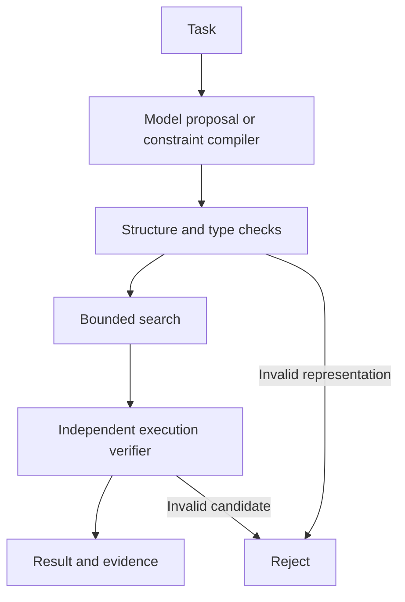

# Harness

**A research runtime for small-model compilation, bounded search and independent verification.**

Harness investigates how much reliable problem-solving can move outside a language model. A model proposes answers or translates a task into structured constraints; executable search produces candidates, and a separate verifier checks them. This repository contains working solvers, optional model adapters, reproducible experiments and observed failures.

**Status:** runnable research prototype. Exact search works in implemented domains. Natural-language compilation is unreliable in the tested configuration. No general intelligence, 120B-model superiority or cost advantage has been established.

## Implemented capabilities

| Capability | Implementation | Boundary |
|---|---|---|
| Arithmetic synthesis | Bounded search, exact fractions, independent AST verifier | Two to six numbers; binary `+ - * /`; each number used once |
| River planning | Breadth-first search, independent set-based simulator | Manually specified actor-agent and boat rules |
| Integer constraints | Generic finite-domain backtracking and assignment verifier | `all_different`, `eq`, `neq`, `lt`, `offset`, `sum_eq` |
| Language compiler | Gemma emits validated constraint JSON | Experimental: 1/3 fixed tests passed |
| Neural adapters | Gemma, HTTP generation, Laya candidate ordering | Proposals are independently checked |
| Retrieval and forecasting | EmbeddingGemma and TimesFM adapters | Separate component checks; no demonstrated planning benefit |
| Workspace | SQLite evidence and verified exact-result cache | Benchmarks never read cached answers |

Reinforcement learning, Monte Carlo tree search, a learned world model and general-purpose automatic compilation are not implemented. The components have not been merged into one neural model or GGUF.

## Architecture



Arithmetic and river tasks can enter search with manually specified rules and no model call. The compiler experiment executes only model-generated constraints. Its withheld reference specification is used afterward for evaluation, never substituted into execution.

**Verifying execution against compiled rules does not prove that those rules captured the English instructions.** A correct solver can answer a mistranslated problem incorrectly.

## Measured results

CPU observations below are specific to the recorded host and settings. Gemma used a community E2B Q4_K_M checkpoint with thinking disabled. Token caps differed by experiment. These small suites are not general capability benchmarks.

| Experiment | Search alone | Gemma alone | Gemma + search |
|---|---|---|---|
| Eight four-number puzzles | 8/8; median 0.0015 s | 0/8; median 2.60 s | 8/8; median 2.65 s |
| Three six-number puzzles | 3/3; median 1.60 s | 0/3; median 3.75 s | 3/3; median 6.26 s |
| Five-pair river puzzle, three seats | Shortest 11-crossing plan; 4.27 ms | Invalid crossing 2; 7.46 s | Verified fallback; 7.46 s |

Success came from exact search. Adding a model did not improve the symbolic-only result. Laya plus search also solved 8/8 arithmetic tasks, with median latency of 0.58 s.

The river task matches the configuration where the authors of [Rethinking the Illusion of Thinking](https://arxiv.org/abs/2507.01231) [reported Gemini 2.5 Pro failures](https://github.com/11inaki11/Rethinking-The-Illusion-of-Thinking). That is external evidence under their conditions. Gemini was not rerun here. A larger model given the same kind of solver may also succeed.

### Natural-language compilation: 1/3 passed

| English problem | End-to-end outcome | Compilation time |
|---|---|---:|
| Six-job schedule | Failed: mistranslated adjacency and invented fixed slots | 78.09 s |
| Robot-to-bay assignment | Failed: invalid constraint arity | 88.45 s |
| Contradictory rankings | Passed: correct translation, proved unsatisfiable | 12.54 s |

Neither satisfiable task passed. Each case used one call, with no gold-informed repair. The solver and cases were hashed before model evaluation. Newly authored instances do not establish unseen-in-training generalization.

Evidence:

- [Initial CPU comparison](reports/run-summary.json)
- [Six-number challenge](docs/harder-run.md)
- [River solution and every crossing](docs/river-run.md)
- [Compiler experiment design](docs/compiler-experiment.md)
- [Compiler outcomes](reports/compiler-results.md) and [raw traces](reports/compiler-run.json)

## Quick start: no model required

Use Python 3.10+ on Linux or macOS. From the repository directory:

```bash
python -m venv .venv
source .venv/bin/activate
python -m pip install -e .
python -m unittest discover -s tests -v
harness bench --mode symbolic --output reports/my-symbolic.json
python scripts/run_river.py --output reports/my-river.json
```

The core uses only the standard library. All **20 unit tests** passed. The existing `python -m thinking_runtime` and `thinking-runtime` entry points remain available alongside `harness`.

## Run Gemma locally

The pinned quantized checkpoint is approximately 3.43 GB. Obtain a compatible llama.cpp `llama-server` binary; the recorded runs used release `b11669`, documented in [the build report](reports/llama-build.json).

```bash
python -m pip install -e '.[download]'
python scripts/download_quantized_gemma.py
python scripts/run_river.py --server /path/to/llama-server --gguf models/gemma-gguf/gemma-4-E2B.Q4_K_M.gguf
python scripts/run_compiler.py --server /path/to/llama-server --gguf models/gemma-gguf/gemma-4-E2B.Q4_K_M.gguf
```

These runners start a localhost-only server and shut it down afterward. The compiler checks frozen source/task hashes before running. Default output paths overwrite local tracked reports when rerun.

For the arithmetic comparison:

```bash
python -m pip install psutil
python scripts/run_local_comparison.py --server /path/to/llama-server --gguf models/gemma-gguf/gemma-4-E2B.Q4_K_M.gguf
```

For the harder suite, append `--tasks examples/harder-arithmetic.json --report-prefix harder --max-tokens 256 --seconds 60 --expansions 200000`.

## Optional specialists

| Role | Pinned upstream model |
|---|---|
| Generator | `google/gemma-4-E2B` |
| Candidate ordering | `convaiinnovations/laya` English |
| Retrieval | `google/embeddinggemma-2` |
| Forecasting | `google/timesfm-2.5-200m-pytorch` |

Exact revisions are in [config/models.json](config/models.json); the quant has a separate [lock file](config/quantized-gemma.json). Downloads record byte counts and SHA256 digests. See [THIRD_PARTY.md](THIRD_PARTY.md) for upstream information.

```bash
python scripts/download_models.py laya embedding timesfm
# Install PyTorch appropriate to your hardware, then the adapters:
python -m pip install -e '.[models]'
python -m pip install 'timesfm @ git+https://github.com/google-research/timesfm.git@e51928e27119cb17bebc005be2696b75e0a9e688'
USE_TF=0 python scripts/smoke_models.py laya embedding timesfm
```

Omitting model names retrieves all four original checkpoints. Allow at least 15 GB for their weights, plus dependencies and temporary space. Full-precision Gemma exceeded the original host's 8 GB memory limit; quantized Gemma subsequently ran. This is not a 4 GB combined stack. Passing component inference checks does not establish downstream quality.

**Model weights, virtual environments, workspace data and credentials are excluded from Git.** Download weights separately; no model binaries are bundled in the source repository.

## Larger-model comparison

Serve an actual baseline through an OpenAI-compatible endpoint and supply its real model ID:

```bash
python -m thinking_runtime bench --mode feedback --backend http --base-url http://localhost:8000/v1 --model YOUR_MODEL_ID --seconds 30 --output reports/large-feedback.json
python -m thinking_runtime bench --mode hybrid --backend http --base-url http://localhost:8000/v1 --model YOUR_MODEL_ID --seconds 30 --output reports/large-hybrid.json
python scripts/compare_reports.py reports/large-hybrid.json reports/large-feedback.json
```

`MODEL_API_KEY` is read from the environment when required. Match task specifications and budgets; include model-only, search-only and larger-model-with-the-same-tools baselines. No paid baseline was run for the recorded results.

## Measurement boundaries

- Cold loading is recorded separately from warm execution.
- Financial cost remains `null` without actual tariffs; local compute is not assumed free.
- CPU times do not predict Mac, Android, GPU or cloud performance.
- Inference-worker RSS was not measured credibly in llama.cpp runs and is marked unknown.
- Synchronous model kernels have cooperative deadlines. Late answers are rejected, but hard cancellation requires worker isolation.
- Benchmark reference specifications are evaluation fixtures, not automatic truth checkers for arbitrary English.

See [research-design.md](docs/research-design.md) for the accuracy, latency and cost protocol.

## Repository map

| Path | Purpose |
|---|---|
| `thinking_runtime/domain.py`, `runtime.py` | Arithmetic representation, verifier and search |
| `thinking_runtime/river.py` | River planner and independent replay verifier |
| `thinking_runtime/constraints.py` | Generic constraint IR, solver and semantic audit |
| `thinking_runtime/adapters.py` | Model and HTTP adapters |
| `thinking_runtime/workspace.py` | SQLite evidence and exact-result storage |
| `scripts/` | Downloads, runners and comparisons |
| `examples/` | Fixed tasks and withheld compiler reference fixtures |
| `reports/` | Actual results, failures and provenance |
| `tests/` | Twenty correctness and boundary tests |

## Next milestone

Improve constraint translation without feeding test references into the model. Evaluate fresh instances and report failures, retries, latency and total resource cost. A useful compiler must preserve the user's rules before a fast solver can help.
